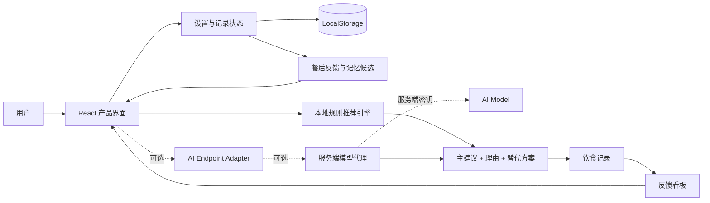

# 味衡 WEIHENG 项目展示

## 1. 项目背景

日常饮食管理通常从“已经吃完之后”开始：记录热量、统计营养、回看数据。但真实压力往往发生在饭前——饿了、时间有限、预算有限，冰箱里只有几样食材，却还要在大量菜单和信息之间反复比较。

味衡把问题前移：**先理解此刻的条件，再给出一份可以马上执行的餐食答案。**

产品不是疾病治疗或医学诊断工具，而是面向普通人的饮食决策辅助系统。

> 产品历史边界：味衡的产品概念与早期静态视觉原型此前已经存在，第一版 React Demo 也已完成。本次新增的是独立重构版本，包括条件解释、餐后反馈、可审核长期记忆、记忆管理、营养区间和三轮质量迭代；不把这些新增成果追溯为此前已经完成的开发。

## 2. 用户痛点

1. **选择过载**：知道“要吃得健康”，却不知道此刻具体吃什么。
2. **条件冲突**：时间、预算、已有食材、口味和目标需要同时权衡。
3. **记录负担高**：精确称重和逐项录入难以长期坚持。
4. **反馈与行动脱节**：数据看板很多，但没有告诉用户下一餐怎么做。
5. **通用建议不贴身**：没有使用已保存的偏好、忌口和最近记录。
6. **AI边界不透明**：用户难以判断系统是在调用模型，还是在使用固定规则。

## 3. 产品核心功能

### 饭前决策

用户输入当前想吃的方向、已有食材、用餐场景、时间、预算、饮食目标和饥饿程度。系统返回：

- 一个主餐建议
- 可核对的推荐理由
- 所需食材与简单制作方式
- 预计时间、成本与营养区间
- 两项可替换方案
- 清晰的推荐来源标注

### 餐后记录

用户可以把推荐直接转为记录，也可以手动添加。记录支持日期、餐次、餐名、食材、备注、营养估算和餐后感受；随后可查看、搜索、修改或删除。

### 长期记忆

推荐餐的餐后反馈会形成待确认记忆。用户可选择写入、忽略或停用；只有已确认的记忆会参与后续排序，餐卡也会解释记忆如何影响判断。

### 反馈分析

系统从真实记录中计算近七日节奏、餐次分布、营养素能量占比和蔬菜出现频率，并把反馈重新连接到下一次决策。

### 个性设置

设置包括目标、偏好、忌口/过敏原、单餐预算与常用食材。设置会持久化，并直接影响下一次推荐表单和候选排序。

## 4. 系统架构

核心对象：

- `DecisionInput`：这一次的用餐条件
- `UserSettings`：长期保存的个人约束
- `Meal`：候选餐、食材、步骤与营养估算
- `Recommendation`：主餐、理由、适配标签与替代方案
- `MealRecord`：真实饮食记录与餐后感受
- `MemoryEntry`：待确认、已确认或已停用的长期偏好信号

## 5. AI 技术应用

### 本次默认使用：本地规则推荐

本地引擎根据以下信号排序：

- 已有食材覆盖
- 可用时间
- 单餐预算
- 饮食目标
- 偏好标签
- 当时想吃的方向
- 饥饿程度
- 用餐场景
- 最近是否重复
- 已确认的长期偏好或回避记忆

忌口与过敏原是硬过滤条件。推荐理由来自实际命中的条件，不调用大模型，也不假称使用了 AI 推理。

### 已预留：安全大模型接入

前端只配置代理 endpoint。可选 `server/ai-proxy.mjs` 在服务端读取模型密钥，构造受约束的提示词，并要求模型只能从候选目录中返回餐食 ID。

服务端会再次：

1. 过滤忌口冲突餐食。
2. 验证模型 JSON 结构。
3. 把餐食 ID 映射回可信目录，不接受模型自行编造的营养数值。
4. 在失败时返回错误，前端回退到本地规则。

本次没有模型 API Key，因此模型链路没有在线实测。展示时必须说明默认推荐是本地规则模式。

## 6. 设计思路

视觉方向为 **Editorial × Modern Wellness × Minimal Product UI**：

- 宣纸色背景、墨色信息层级、番茄红行动色与酸橙绿状态色
- 宋体式展示标题与克制的无衬线正文
- 一餐卡作为核心产品对象，而不是普通聊天框
- 推荐理由、营养、食材和执行步骤在同一信息面板内完成
- 桌面使用编辑式分栏，移动端使用底部主导航和单列卡片
- 无外部图片和字体依赖，离线也可保持完整视觉

## 7. 实际完成情况

| 能力 | 状态 | 说明 |
| --- | --- | --- |
| 偏好、目标、忌口、预算、常用食材设置 | 已实现 | LocalStorage 持久化 |
| 根据条件生成不同餐食建议 | 已实现 | 本地可解释规则，输入变化会影响排序 |
| 忌口/过敏原硬过滤 | 已实现 | 有独立单元测试 |
| 主建议、理由、食材、步骤、营养估算、替代方案 | 已实现 | 完整一餐卡 |
| 推荐转记录、手动添加、修改、删除 | 已实现 | 浏览器端到端验证 |
| 刷新后设置和记录保留 | 已实现 | 已实测 |
| 近七日节奏、餐次分布、营养结构、饮食反馈 | 已实现 | 基于记录估算 |
| 餐后轻量反馈 | 已实现 | 还想再吃 / 一般 / 不太合适 |
| 记忆候选、确认、忽略与停用 | 已实现 | 确认后才影响推荐 |
| 长期记忆进入下一次推荐并解释原因 | 已实现 | Chrome 端到端验证 |
| 示例与用户数据边界 | 已实现 | 示例餐盘明确标记 |
| 桌面与移动端响应式 | 已实现 | 390px 视口验证无横向溢出 |
| 真实模型调用 | 可选接入已实现 | 未配置密钥，未在线验证 |
| 公开部署 | 未完成 | 等待账号和公开发布授权 |

## 8. 演示方式

1. 在首页查看今日餐盘和近七日节奏。
2. 进入“决定一餐”，输入想吃的方向与食材条件。
3. 生成餐卡，说明推荐来源、判断路径、营养区间边界。
4. 切换一项替代餐，再将主餐转为饮食记录，并选择“还想再吃”。
5. 打开“反馈与记忆”，确认一条记忆候选。
6. 再次生成推荐，确认长期记忆已进入判断。
7. 回反馈页停用记忆，说明控制权；再展示设置与忌口边界。

完整 60—90 秒脚本见 [DEMO_SCRIPT.md](DEMO_SCRIPT.md)。

## 9. 项目亮点

1. **完整的饭前到饭后闭环**：不是单页概念图，也不是只有聊天框。
2. **透明度优先**：明确区分本地规则和真实模型，不制造能力假象。
3. **安全边界前置**：忌口在候选生成阶段就被排除，模型侧仍有第二层校验。
4. **低摩擦、可审核的记忆更新**：一次反馈不会暗中变成标签，先候选、再确认、可停用。
5. **反馈能改变行动**：已确认记忆会进入下一次排序，而不只是做一张图表。
6. **可验证的质量迭代**：10 项单元测试、24 项 Chrome 端到端检查和三轮实际修改记录。

## 10. 当前局限

- 8 条餐食不足以覆盖完整饮食场景。
- 本地规则不是自然语言大模型，对复杂表达的理解有限。
- 营养估算没有真实份量、品牌或烹饪损耗数据。
- 没有账户、多设备同步、食材识别或外部餐单连接。
- 模型代理尚无具体供应商在线验收。
- GitHub 源码仓库公开存在，但原 GitHub Pages 地址当前返回 404；新版尚未发布公开 URL。

## 11. 后续迭代方向

1. 接入经过验证的营养数据库，并允许用户调整份量。
2. 增加真实模型供应商适配、结构化输出评测与失败回退监控。
3. 加入“一周备餐”与剩余食材跨餐规划。
4. 增加更细的偏好反馈，例如“太油”“份量合适”“做法太麻烦”。
5. 引入账户与端到端加密的多设备同步。
6. 进行真实用户可用性测试，验证决策时间是否下降，而不是虚构转化率。
